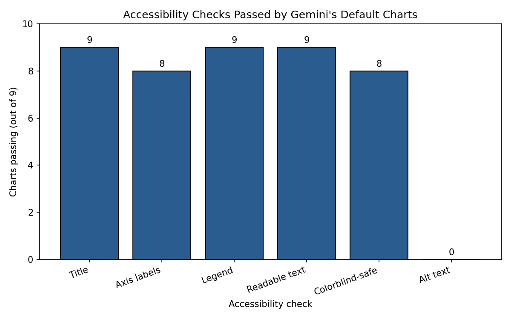

# Do LLMs Make Accessible Charts? A Small Default-Behavior Check

A small pilot check of whether an AI assistant's default charts meet basic accessibility criteria when a student asks for a chart in plain language.

## Goal

Students often ask AI assistants for chart code and paste it straight into their work. This project asks: if nobody mentions accessibility, how accessible are the charts they get?

## Method

- 10 chart requests covering different chart types (bar, line, pie, two-line, grouped bar, scatter, stacked bar, histogram, multi-line, heatmap). Each request includes its data and asks for Python matplotlib code.
- One assistant: Gemini (Flash), November 2026. One fresh chat per request, request pasted exactly as written, no follow-up questions. (Chart 1 was first run with extra text pasted by mistake, so it was redone with the clean request and only the clean result is used.)
- I ran each answer's code in Google Colab without changing it, and scored the resulting chart on 6 checks (1 point each):

| # | Check | Passes if... |
|---|---|---|
| 1 | Title | Clear title saying what the chart shows |
| 2 | Axis labels | Both axes labeled (charts without axes count as pass) |
| 3 | Legend | Groups can be identified (single-group charts count as pass) |
| 4 | Readable text | All text readable at normal size |
| 5 | Colorblind-safe | Groups are distinguishable without relying on color alone (markers, direct labels or printed values) |
| 6 | Alt text | The answer includes a text description of what the chart shows |

## Results

- 9 of 10 charts ran. **Chart 7 (stacked bar) failed**: the code defined `instore_sales` but used `in_store_sales`, causing a NameError. It was left out of the scores.
- 7 of the 9 charts scored 5/6, and 2 scored 4/6.

| Check | Charts passing (of 9) |
|---|---|
| Title | 9 |
| Axis labels | 8 |
| Legend | 9 |
| Readable text | 9 |
| Colorblind-safe | 8 |
| Alt text | 0 |

Main finding: the charts looked fine visually, but **none of the 9 came with a description of what the chart shows**. The text around the code was only an introduction ("Here is the Python code...") or an offer to change the chart.

Other observations:
- Chart 4: pass and fail lines differ only by color (green vs. red) with the same markers, so they fail the colorblind check. The request itself asked for those colors.
- Chart 5: no x-axis label.
- Chart 8: the y-axis shows half-students (0.5, 1.5, ...).
- Chart 9: the legend overlaps the start of one line.
- Chart 10: the "Week" axis title crowds the tick labels.
- In one follow-up offer, the assistant mixed up chart types (it offered to convert a "heatmap" under a grouped bar chart).

## Limitations

- Only one assistant, one run per request, and only 10 requests, so this is not a general claim about LLMs.
- Scoring was done by one person (me), so the scores involve judgment.
- The colorblind check was judged by looking for a second cue besides color, not by running a color-vision simulation.
- The requests were written by me and include data, so they may be easier than real student requests.

## Future work

- Repeat with several assistants and several runs per request.
- Test whether asking for "accessible" charts changes the result.
- Add a second scorer and report agreement.
- Use a color-vision simulation for the colorblind check.

## Files

- `chart_requests.csv`: the 10 requests
- `ai_responses.txt`: the assistant's full answers
- `scores.csv`: scores per chart
- `chart_accessibility.ipynb`: Colab notebook with the code and the summary chart
- `chart_1.png` to `chart_10.png` (no chart 7): the generated charts
- `summary_chart.png`: summary of the checks

## Tools

Python, matplotlib, Google Colab