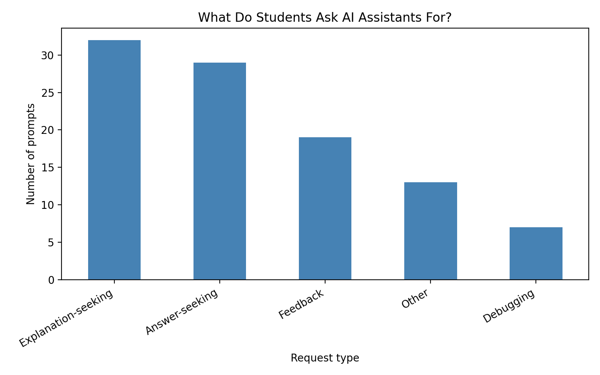
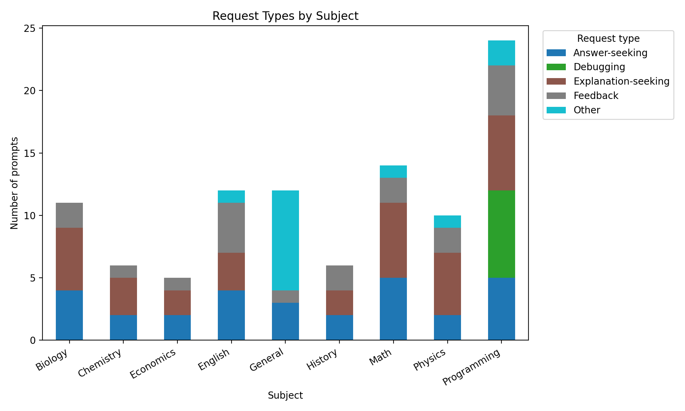

# How Do Students Use LLMs? A Pilot Labeling Study

A small pilot study that sorts student requests to AI assistants into five types and looks at how those types differ across school subjects.

## Goal

When students use AI assistants, some ask for finished answers and some ask for help understanding. This project tests a simple five-category labeling scheme for that difference, as a first step toward analyzing real student-LLM conversations.

## Data

- 100 student-style prompts across 9 subjects (Math, Programming, Biology, English, Physics, History, Economics, Chemistry, General).
- The prompts were written by me to imitate realistic student requests. They are not real student data**, so the results below describe this sample only and say nothing about real students.

## Labeling scheme

Each prompt gets one label based on what the student wants from the AI:

| Label | Meaning |

| Answer-seeking | Wants a finished result (solution, essay, full code) |
| Explanation-seeking | Wants to understand a concept |
| Debugging | Has broken code or an error |
| Feedback | Shares their own work and asks for a check |
| Other | Study tips, planning, recommendations |

## Results (my labels, n = 100)

| Label | Count |

| Explanation-seeking | 32 |
| Answer-seeking | 29 |
| Feedback | 19 |
| Other | 13 |
| Debugging | 7 |

Patterns in this sample: all Debugging prompts fall under Programming, and the General subject is mostly "Other".

## Labeler agreement

A friend (not a researcher) independently labeled the first 30 prompts using the same rules. We agreed on 26 of 30 (86.7%), Cohen's kappa = 0.83. All 4 disagreements were "Write ..." requests (a Python function, a full program, an essay and a poem): I labeled them Answer-seeking and she labeled them Other. This suggests the scheme needs a clearer rule for creative or open-ended writing requests.

## Limitations

- Prompts are hand-written, not collected from real students.
- Only 100 prompts and one main labeler.
- Some prompts are borderline between two categories (for example, a general "how do I explain X" question), so labels involve judgment.
- Agreement was measured on only 30 prompts with a single second labeler, so the kappa value is a rough estimate.

## Future work

- Apply the same labeling scheme to real, anonymized student-LLM conversations.
- Study whether answer-seeking and explanation-seeking requests lead to different learning outcomes.
- Extend the scheme to multi-turn conversations.

## Files

- `prompts.csv`: the 100 prompts
- `Labeled_prompts.csv.csv`: prompts with my labels
- `student_llm_usage.ipynb`: Colab notebook with the analysis
- `chart_label_counts.png`, `chart_by_subject.png`: charts

## Tools

Python, pandas, matplotlib (Google Colab)
