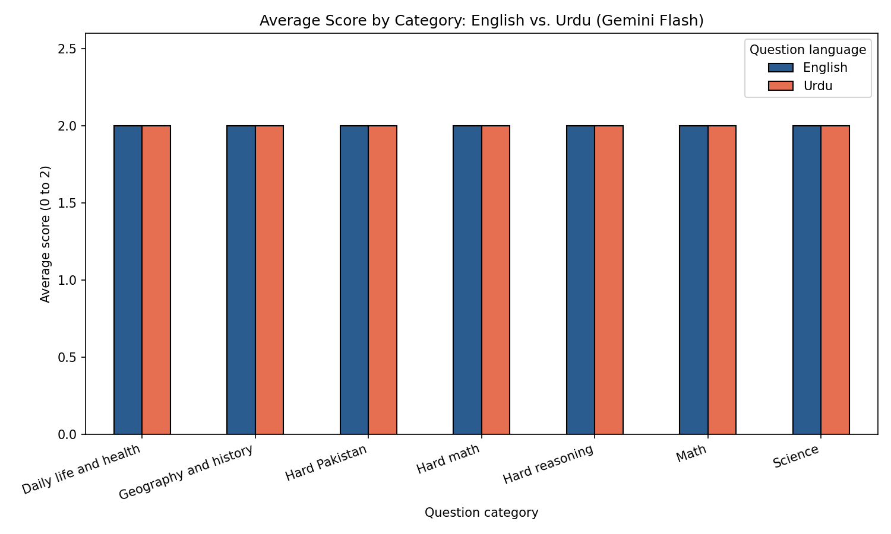

# Urdu vs. English: Does an AI Assistant Answer Equally Well?

A small pilot check of whether an AI assistant gives equally accurate answers to the same questions asked in English and in Urdu.

## Goal

Urdu is a widely spoken but low-resource language in AI. This project asks a simple first question: on everyday school and general-knowledge questions, does an assistant answer as accurately in Urdu as in English?

## Method

- 30 questions, each written in English and in Urdu (60 prompts in total).
- Easy set (20 questions): Science, Math, Geography and history (Pakistan-focused), Daily life and health. Hard set (10 questions): multi-step math word problems, Pakistan-specific history and culture, and reasoning questions.
- Each question has a reference answer that I wrote down before asking.
- One assistant: Gemini (Flash), November 2026. A fresh chat for every question, the question pasted exactly as written, no follow-up questions.
- I scored every answer myself: 2 = correct, 1 = partly correct, 0 = wrong or no answer. English answers were scored first, then Urdu answers, without looking at the English scores. For Urdu I also recorded whether the answer was written in Urdu.
- Where Gemini added extra details, I scored the main answer and noted any clear errors in the extras. Where the answer included an image, only the text was scored.

## Results

- English: 30 of 30 answers scored 2.
- Urdu: 30 of 30 answers scored 2. All 30 Urdu answers were written in Urdu script (with some English terms and Western numerals mixed in, which is normal in Urdu writing).
- No difference was found between English and Urdu, in either the easy set or the hard set.

In this sample the assistant performed at the maximum score in both languages, so the questions could not separate the two languages (a ceiling effect). This is a "no gap found on these questions" result. It does not show that Urdu and English performance are equal in general.

Small observations:
- One English-to-Urdu math question mixed Urdu text with an equation, and I added invisible direction marks so the equation displayed correctly. I did not test whether this affects the assistant.
- Some answers (in both languages) included images or long extra explanations.
- One minor inaccuracy in an extra detail was noted in the English answer to the capital-of-Pakistan question, and it did not change the score.

## Limitations

- One assistant, one run per question, and only 30 questions.
- The questions are factual with one clear answer, so they are easy for a strong assistant. They do not test reasoning in depth, long answers, or dialects.
- I drafted the questions with AI help. I am a native Urdu speaker and corrected the Urdu wording, but I did not have a second person check it.
- I was the only scorer, so there is no agreement measure.
- Scores are only on correctness. I did not rate fluency, tone, or register of the Urdu.

## Future work

- Add much harder questions (long reasoning, culture and idioms, local news and law) to find where a gap begins.
- Compare several assistants and several runs per question.
- Test Roman Urdu, which many people use when typing.
- Add a second scorer and report agreement.
- Score the quality of the Urdu writing, not just correctness.

## Files

- `questions.csv`: the 30 questions in English and Urdu with reference answers
- `answers_en.txt`, `answers_ur.txt`: the assistant's answers
- `scores.csv`: my scores for each answer
- `urdu_vs_english.ipynb`: Colab notebook with the analysis
- `scores_by_category.png`: chart of average scores
- Screenshots of answers that included images or formatted math

## Tools

Python, pandas, matplotlib (Google Colab)